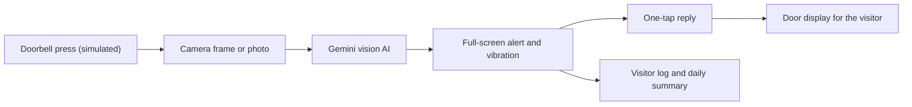

cd ~/seebell

cat > README.md << 'EOF'
<div align="center">

# SeeBell

### A doorbell you can see.

A Ring-powered doorbell for people who can't hear it: full-screen visual alerts, an AI that tells you who is outside, and one-tap replies the visitor can read.


Built for the **Amazon Developer Hackathon**, Ring track (accessibility).


</div>

---

## The problem

Over 400 million people worldwide have disabling hearing loss, and the doorbell is still a sound-only product. If you can't hear it, you miss deliveries, visitors and sometimes safety warnings. If you can hear it, you still only learn that *someone* is there, not who.

## What SeeBell does

When someone rings, SeeBell turns that moment into something you cannot miss and can understand at a glance:

1. The whole screen **flashes** (green, amber or red by risk level), the text is huge, and the phone **vibrates**.
2. A camera frame goes to **Google Gemini**, which says who is there, whether they carry a package, how risky it looks, and what reply it suggests.
3. You tap **Coming**, **Leave at door** or **Not now**.
4. The visitor sees your answer in big text on a **door display** page.
5. Everything lands in a **visitor log** with snapshots, plus an AI-written **daily summary**.



## Screens

<table>
  <tr>
    <td width="50%"><b>Door display</b><br>The visitor reads your reply in big text.<br><br></td>
    <td width="50%"><b>Home</b><br>Demo controls, Ring camera check and daily summary.<br><br></td>
  </tr>
</table>

**Visitor log and daily summary**


## Features

- **Full-screen visual alert**: flashing color by risk level, huge text, phone vibration, and an `aria-live` alert dialog for screen readers.
- **AI visitor description**: Gemini returns a strict JSON result (`visitor_type`, `description`, `carrying`, `risk`, `risk_reason`, `suggested_action`). Output is validated, and the app falls back safely if the AI fails.
- **One-tap replies**: the suggested reply is highlighted.
- **Door display (`/door`)**: updates live with your reply, large text, high contrast.
- **Visitor log**: timeline with snapshots, AI descriptions, risk level and your replies. Each entry says whether the answer came from Gemini or from demo mode.
- **Daily summary**: today's visitors are counted in code, then Gemini writes a short summary from those counts.
- **Ring API check**: a panel that calls the Ring API and lists your Ring device.

## Accessibility by design

- Risk is never shown by color alone: every alert also carries a text label (LOW, MEDIUM or HIGH RISK).
- Alert text starts at 3xl and grows to 8xl on large screens. Buttons are large touch targets.
- Vibration pattern on every new ring (`navigator.vibrate`) for phones.
- Screen-reader support: alert dialog with `aria-live="assertive"`, labelled buttons, and `aria-live="polite"` on the door display.
- The AI describes only what is visible. It never guesses names or identities.

## What is real and what is simulated

The Ring Developer Playground has no real doorbell-press events, no webhooks in token mode, and a device with no speaker. So we are open about what is what:

| Part | Status |
|---|---|
| Ring API connection (device lookup with a Playground token) | Real |
| AI visitor analysis (Gemini) | Real |
| Alert, vibration, replies, door display, visitor log, daily summary | Real |
| Doorbell press | Simulated with a button |
| Camera frame given to the AI | An uploaded photo stands in for it |
| Speaking to the visitor through the doorbell | Not possible with the Playground device, so the reply is shown as text on the door display |

The starter's own dashboard at `/` still shows the live Playground camera stream.

## Tech stack

Next.js 15 (App Router), TypeScript, Tailwind CSS, Ring API, Google Gemini API.

## What's new vs Amazon's starter

SeeBell starts from Amazon's MIT-licensed [`ring-api-helloworld`](https://github.com/AmazonAppDev/ring-api-helloworld) starter. The starter's Ring code (`app/api/ring/*`, `lib/auth.ts`) is kept and used. Everything below was added during the hackathon:

| File | What it does |
|---|---|
| `lib/seebell.ts` | Types, mock scenarios, reply actions, in-memory store |
| `lib/gemini.ts` | Gemini vision call, strict JSON contract, validation, fallback |
| `app/api/simulate-ring` | Simulated ring: mock scenario, or photo plus real AI |
| `app/api/state`, `app/api/action` | Live state and reply handling |
| `app/api/summary` | Daily summary |
| `app/seebell/page.tsx` | Alert screen, demo controls, visitor log, summary |
| `app/door/page.tsx` | Visitor-facing door display |
| `RingPanel` component | Ring API device check |

## Getting started

**Prerequisites:** Node.js 18 or newer, a free [Ring Developer](https://developer.amazon.com/ring) account, and (optional) a free Gemini API key.

```bash
git clone https://github.com/Sindhu0012/seebell.git
cd seebell
npm install
cp .env.example .env.local
```

Open `.env.local` and fill it in:

| Variable | Required | What it is |
|---|---|---|
| `RING_ACCESS_TOKEN` | For the Ring check | Token from the [Ring Developer Playground](https://developer.amazon.com/ring/console/playground). It expires after about 30 minutes. |
| `GEMINI_API_KEY` | For real AI | Free key from [Google AI Studio](https://aistudio.google.com/apikey). Without it, the app runs in demo mode with canned answers. |
| `GEMINI_MODEL` | No | The default in code is `gemini-2.5-flash`. If you get a 404, set a model your key supports (we developed with `gemini-3.8-flash`). |
| `AI_MOCK` | No | Set to `true` to skip Gemini entirely. |

Then run:

```bash
npm run dev
```

1. Open http://localhost:3000/seebell
2. Open http://localhost:3000/door in a second tab for the visitor display.
3. Click a **Simulate** button, or **Ring with a photo (real AI)** and pick a photo.
4. Tap a reply and watch the door tab change.

Never commit `.env.local`. It is already in `.gitignore`.

## Troubleshooting

- **`EADDRINUSE` on start:** run `fuser -k 3000/tcp`, then `npm run dev` again.
- **401 from the Ring API or the dashboard at `/`:** the Playground token expired. Create a new one and update `.env.local`.
- **Changed `.env.local` but nothing happened:** restart the dev server, env files load only at startup.
- **Visitor log says "demo mode":** the Gemini key is missing, `AI_MOCK=true`, or the call failed. Check the terminal for a Gemini error line.
- **Gemini returns 404:** set `GEMINI_MODEL` to a model available to your key.

## Privacy and AI notes

- Free-tier Gemini inputs may be used by Google to improve its products. Only use photos of yourself or of people who agreed.
- AI output describes what is visible and can be wrong. Treat the risk level as a hint, not a verdict.
- No keys or tokens are stored in this repo.

## Limitations

- Ring events are simulated (see above).
- The visitor log lives in memory and resets when the server restarts.
- Live camera frames are not sent to the AI yet; the starter exposes a video stream but no snapshot endpoint.

## Ideas for next

- Real Ring events through webhooks with OAuth refresh-token mode
- Live camera snapshots into the AI step
- Amazon Bedrock as an alternative to Gemini
- Persistent storage, plus push or SMS alerts
- Smart-light flashing and more languages on the door display

## License

MIT. See [LICENSE](LICENSE). Built on Amazon's MIT-licensed `ring-api-helloworld` starter.
EOF

for f in alert-ai door home log-summary; do
  if [ -f "docs/screenshots/$f.png" ]; then echo "ok: $f.png"; else echo "MISSING: $f.png"; fi
done

git add .
git status --short | grep env
git commit -m "Add README with screenshots"
git push
